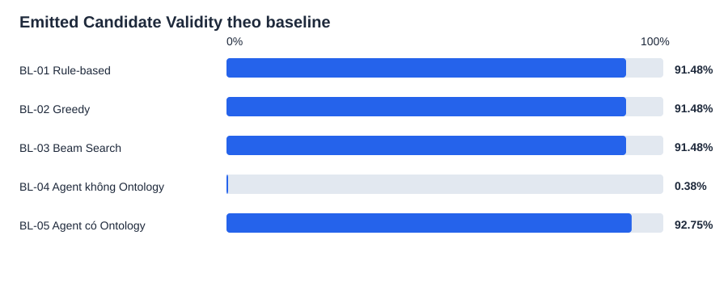
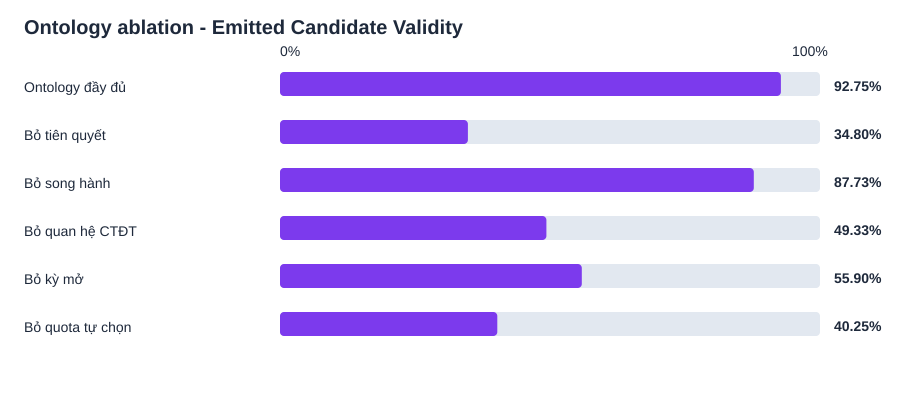

# Experimental Results

> **Legacy artifact notice:** this table was generated under the v4/v2 protocol. It is retained for traceability only and must not be used as final Results. Regenerate it after completing the clean-source v5/v3 runs.

This document is generated from frozen experiment artifacts by `scripts/build_results_summary.py`. It is a paper-ready Results draft, not a claim that proxy academic policies are official NTU regulations.

## Experimental setting

All baseline and ontology-component ablation runs use 364 pseudonymised profiles, `target_term_id=next-term`, target-credit cap 18, common search budget, and seeds 41–50 for stochastic methods. The no-ontology agent artifact is the controlled rerun used by Stage 6. E2E and confirmation results are reported separately because they evaluate contracts and transaction safety, not comparative recommendation quality.

## Metric interpretation

`Internal Generation Yield` is emitted candidates divided by all internal generation attempts. `Emitted Candidate Validity` is validator-valid emitted candidates divided by candidates emitted for validation. The two quantities must not be merged because duplicate/empty/rejected internal search attempts do not reach validation.

`Final Recommendation Coverage` is the proportion of requests for which at least one validator-valid plan is available. None of these metrics is system accuracy.

## Baseline comparison

| Method | Internal Generation Yield | Emitted Candidate Validity | Final Recommendation Coverage | No-plan Rate | Mean latency (s) |
|---|---:|---:|---:|---:|---:|
| BL-01 Rule-based | 100.00% | 91.48% | 91.48% | 8.52% | 1.243 |
| BL-02 Greedy | 100.00% | 91.48% | 91.48% | 8.52% | 0.919 |
| BL-03 Beam Search | 100.00% ± 0.00% | 91.48% ± 0.00% | 91.48% ± 0.00% | 8.52% | 1.060 |
| BL-04 Agent không Ontology | 100.00% ± 0.00% | 0.38% ± 0.14% | 1.13% ± 0.42% | 98.87% | 12.230 |
| BL-05 Agent có Ontology | 67.79% ± 9.74% | 92.75% ± 0.34% | 91.43% ± 0.17% | 8.57% | 2.406 |

All final recommendations are validator-gated. Therefore, the central ontology comparison is BL-04 versus BL-05, reported with the three harmonised metrics after both experiments are rerun. Do not reuse pre-v4 values because their denominators are not comparable with the ablation run.

## RQ1 — Ontology component ablation

| Generator configuration | Internal Generation Yield | Emitted Candidate Validity | Final Recommendation Coverage | Change from full | Violations of removed rule |
|---|---:|---:|---:|---:|---:|
| Ontology đầy đủ | 67.80% ± 9.74% | 92.75% ± 0.34% | 91.48% ± 0.00% | +0.00 pp | 0 |
| Bỏ tiên quyết | 59.65% ± 7.08% | 34.80% ± 3.77% | 33.79% ± 0.29% | -57.95 pp | 10179 |
| Bỏ song hành | 64.62% ± 7.42% | 87.73% ± 0.38% | 86.81% ± 0.00% | -5.02 pp | 381 |
| Bỏ quan hệ CTĐT | 82.34% ± 5.27% | 49.33% ± 3.31% | 60.03% ± 1.44% | -43.42 pp | 12492 |
| Bỏ kỳ mở | 69.93% ± 8.53% | 55.90% ± 2.37% | 60.33% ± 0.60% | -36.85 pp | 4736 |
| Bỏ quota tự chọn | 80.19% ± 5.98% | 40.25% ± 4.42% | 51.37% ± 1.43% | -52.50 pp | 21111 |

The full ontology evaluator remains active in every ablation; therefore the table measures the contribution of each relation family to **generating valid candidates**, rather than weakening the evaluator. Numerical claims must be regenerated under the harmonised metric contract.

## End-to-end contract evidence

The frozen E2E matrix reports 11/11 passed contracts, 27/33 Candidate Attempt Validity (81.82%), 11/11 negative probes, 9/9 applicable re-planning cases, and 100.00% average evidence coverage. These results establish integration/contract coverage only; they do not establish superiority over baselines or completeness of institutional policies.

## Confirmation and freshness experiment

The confirmation experiment contains 20 feedback-ready, pseudonymised profiles: 12 unchanged-source confirmations, 4 student-snapshot stale probes, and 4 knowledge-snapshot stale probes. The runner replaced two non-feedback-ready profiles during deterministic selection.

| Metric | Result |
|---|---:|
| Confirmation Success Rate (unchanged source) | 100.00% |
| Final Validation Pass Rate (unchanged source) | 100.00% |
| Stale Detection Rate | 100.00% |
| Unsafe Confirmation Rate | 0.00% |
| Refresh Lineage Rate | 100.00% |
| Feedback-ready coverage while sampling | 90.91% |

No stale probe was committed as confirmed. This supports transaction freshness of the human-in-the-loop confirmation workflow; it is not a human acceptance study.

## Scope and limitations

- Curriculum, prerequisite/corequisite, quota, offering and calendar sources remain provisional/proxy/unavailable until mapped to versioned official NTU documents.
- Human evaluation has not yet been conducted; Advisor Agreement, Acceptance Rate, Edit Distance, NDCG@3/MRR, usefulness and trust must not be reported as measured results.
- External validation on the Illinois prerequisite dataset remains future work.

## Artifact provenance

- Baselines: `artifacts/stage6_baselines/20261010T084556Z`.
- Ablation: `artifacts/ontology_ablation/20261011T095123803860Z`.
- E2E: `artifacts/e2e_scenarios/20260916T115000Z`.
- Confirmation: `artifacts/confirmation_experiment/20261006T034141939726Z`.
